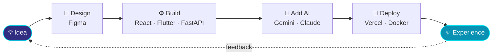
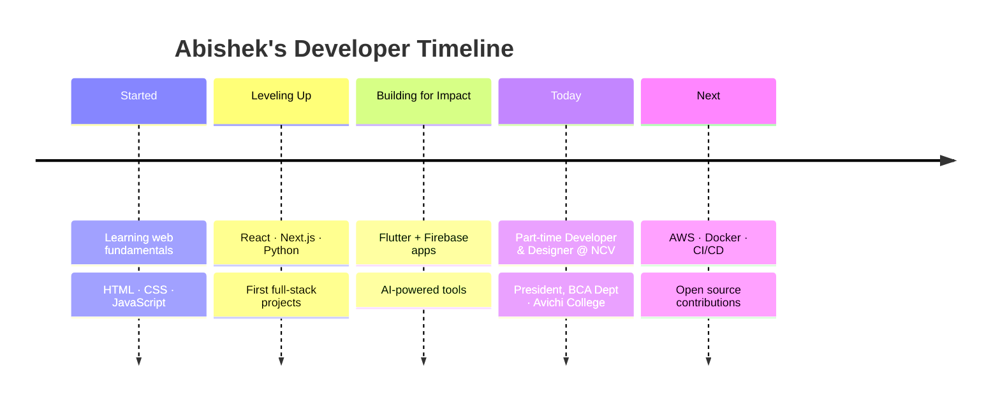

<!-- ═══════════════════════════════════════════════════════ -->
<!--                MUTHU ABISHEK M                          -->
<!--   TURNING COMPLEX PROBLEM INTO SIMPLE SOLUTION          -->
<!-- ═══════════════════════════════════════════════════════ -->

<div align="center">


<br/>

<a href="https://github.com/abishek16-coder"></a>


<br/><br/>

> ### *"I don't just write code. I build experiences."*

</div>


<div align="center">

# ◈ ACT I — THE DEVELOPER BEHIND THE CODE

</div>

Hey, I'm **Abishek** 👋 — a BCA student, full-stack developer and designer who loves turning raw ideas into polished, real-world products. From mobile apps to AI-powered tools, I build things that are useful, beautiful and meaningful.

<div align="center">


</div>

```ts
// abishek.ts
const abishek = {
  role:     "Full Stack Developer & Designer",
  studying: "BCA · Avichi College",
  working:  "Part-time @ NCV Charitable Trust",
  leading:  ["President — BCA Department", "Executive — Tamil Natramil Mandram"],
  currently: ["AI-powered apps", "AWS & DevOps", "Advanced UI/UX"],
  funFact:  "I ship ideas faster than I finish my coffee ☕",
  motto:    "THINK • CREATE • INNOVATE • REPEAT",
};
```

<table>
<tr>
<td width="50%" valign="top">

### ◉ WHO I AM

- 💻 Full Stack Developer (web + mobile)
- 🤖 AI & Automation Explorer
- 🎨 UI/UX Enthusiast
- ☁️ Cloud & DevOps Learner
- 🎓 Student leader & community builder

</td>
<td width="50%" valign="top">

### ◉ WHAT I DO

- Build modern, fast web applications
- Develop cross-platform mobile apps
- Integrate AI into real products
- Design clean, cinematic interfaces
- Create software that serves people

</td>
</tr>
</table>


<div align="center">

# ⚡ ACT II — THE TECHNOLOGY UNIVERSE

*Tools I use to turn imagination into reality.*


<br/>

<br/>

<br/>

<br/>


<br/><br/>


</div>

<br/>

<div align="center">

### 🧬 HOW I BUILD

</div>




<div align="center">

# 🚀 ACT III — SELECTED PROJECTS

*Ideas transformed into working applications.*

</div>

<table>
<tr>
<td width="50%" valign="top">

### 🧠 QUANTUM ML DETECTION
Exploring where machine learning meets quantum computing concepts.


<a href="https://github.com/abishek16-coder/quantum_ml-detection"></a>

</td>
<td width="50%" valign="top">

### 🍱 KINDBITE
A food donation app connecting donors with people in need — technology with a heart.


<a href="https://github.com/abishek16-coder"></a>

</td>
</tr>
<tr>
<td width="50%" valign="top">

### 📧 INBOX GUARDIAN
An AI-powered Gmail spam detection application that keeps your inbox clean.


<a href="https://github.com/abishek16-coder"></a>

</td>
<td width="50%" valign="top">

### 📄 DOC GEN PRO
A document generation platform with a modern frontend and a fast backend.


<a href="https://github.com/abishek16-coder"></a>

</td>
</tr>
<tr>
<td width="50%" valign="top">

### 🔐 SECURE QR GENERATOR
A secure QR code generation app built for safe sharing.


<a href="https://github.com/abishek16-coder"></a>

</td>
<td width="50%" valign="top">

### 💰 EXPENSE TRACKER
A personal finance tracker that makes money habits visible.


<a href="https://github.com/abishek16-coder"></a>

</td>
</tr>
</table>

<div align="center">

<a href="https://github.com/abishek16-coder?tab=repositories"></a>

</div>


<div align="center">

# 🛤️ ACT IV — THE JOURNEY

</div>




<div align="center">

# 📊 ACT V — GITHUB ANALYTICS

*Every contribution tells a story.*


<br/><br/>


<br/><br/>


<br/><br/>


</div>


<div align="center">

# 🐍 ACT VI — ONE COMMIT AT A TIME


</div>


<div align="center">

# 🎯 ACT VII — MISSION CONTROL

</div>

| 🛰️ Mission | 📡 Status | 📈 Progress |
| :-- | :-: | :-- |
| Full Stack Development | ⚡ Learning & Building |  |
| AI-powered Applications | 🤖 Exploring |  |
| Advanced UI/UX | 🎨 Improving |  |
| Docker & CI/CD | 🐳 Learning |  |
| AWS & Cloud | ☁️ Exploring |  |
| Open Source Contributions | 🚀 Growing |  |


<div align="center">

# 🌐 FINALE — LET'S CONNECT

*Great ideas become greater when people collaborate.*

<a href="https://github.com/abishek16-coder"></a>
<!-- Replace the links below with your real URLs, then remove the comment markers -->
<!-- <a href="YOUR_LINKEDIN_URL"></a> -->
<!-- <a href="YOUR_PORTFOLIO_URL"></a> -->
<!-- <a href="mailto:YOUR_EMAIL"></a> -->

<br/><br/>


<br/>


<sub>CRAFTED WITH PASSION BY ABISHEK · 2026</sub>

</div>
