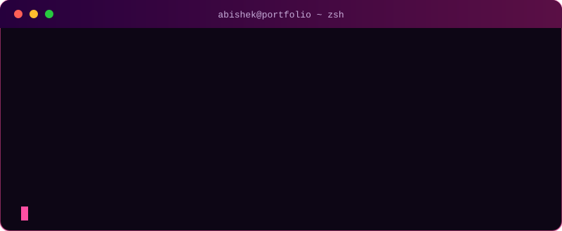

 

 

  

<!-- ══════════ 01 · ABOUT ══════════ -->

### ▌01 &nbsp;/&nbsp; ABOUT ME

<table>
<tr>
<td width="58%" valign="top">

#### 👋 Hey, I'm **Abishek**

I'm a **BCA student** who builds across **web, mobile and AI**. I like products that are useful first and beautiful second — and I especially enjoy building software for community and charitable work.

| | |
|---|---|
| 🚀 **Building** | Full-stack apps, AI chatbots and agent workflows |
| 🎓 **Studying** | BCA at Avichi College of Arts and Science |
| 🔭 **Exploring** | AWS, DevOps, system design |
| 🤝 **Leading** | BCA department president · Tamil Natramil Mandram executive member |

> 💬 *"Turning complex problems into simple solutions."*

</td>
<td width="42%" align="center" valign="middle">

</td>
</tr>
</table>

<!-- ══════════ 02 · STACK ══════════ -->

### ▌02 &nbsp;/&nbsp; TECH ARSENAL

⚡ TOOLS OF THE TRADE ⚡

  

**🎨 FRONTEND** 

 

**⚙️ BACKEND & DATABASE** 

 

**📱 MOBILE · DEVOPS · TOOLS** 

  

<!-- ══════════ 03 · WORK ══════════ -->

### ▌03 &nbsp;/&nbsp; FEATURED BUILDS

🎬 SELECTED WORKS 🎬

<table>
<tr>
<td width="50%" valign="top">

#### 🍱 KindBite
**Food Donation Platform**

Connects donors with people and organisations who can use surplus food — fighting waste, feeding communities.

</td>
<td width="50%" valign="top">

#### 📄 Doc Gen Pro
**Document Generation Platform**

Streamlined workflow for generating documents from the browser, built with React and FastAPI.

</td>
</tr>
<tr>
<td width="50%" valign="top">

#### 🛡️ Inbox Guardian
**AI Gmail Spam Detection**

Email analysis with Gmail integration and secure OAuth 2.0 sign-in.

</td>
<td width="50%" valign="top">

#### 🧭 AI Trip Planner
**AI-Powered Travel Planning**

AI-generated itineraries with booking requests sent straight to the owner's inbox.

</td>
</tr>
<tr>
<td width="50%" valign="top">

#### 🔐 Secure QR Generator
**QR Generation &amp; Protection**

QR codes with security-focused features built on cryptography.

</td>
<td width="50%" valign="top">

#### 💸 Expense Tracker
**Personal Finance Tool**

A simple interface to record and review everyday spending.

</td>
</tr>
</table>

✨ More experiments, builds and ideas are always in progress ✨

<!-- ══════════ 04 · ACTIVITY ══════════ -->

### ▌04 &nbsp;/&nbsp; GITHUB ACTIVITY

📈 THE GRIND, VISUALIZED 📈

  

 

  

<!-- Snake: generated by .github/workflows/snake.yml -->
<picture>
  <source media="(prefers-color-scheme: dark)" srcset="https://raw.githubusercontent.com/abishek16-coder/abishek16-coder/output/github-contribution-grid-snake-dark.svg" />
  <source media="(prefers-color-scheme: light)" srcset="https://raw.githubusercontent.com/abishek16-coder/abishek16-coder/output/github-contribution-grid-snake.svg" />
  
</picture>

 

<!-- ══════════ 05 · EXPLORING ══════════ -->

### ▌05 &nbsp;/&nbsp; CURRENTLY EXPLORING

 

 

<!-- ══════════ 06 · CONNECT ══════════ -->

### ▌06 &nbsp;/&nbsp; LET'S CONNECT

 

<!-- Add your own links, then remove the comment markers

-->

  

 

**CODE • CREATE • INNOVATE**

Learn by building. © Abishek

